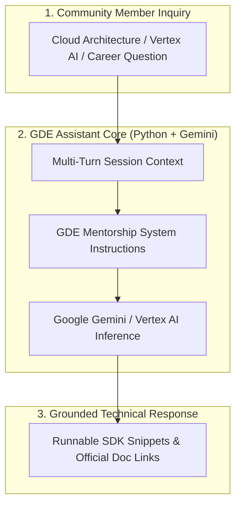

# GDE-Chatbot

> **Author & Architect:** [Robina Mirbahar](https://github.com/RobinaMirbahar) (Google Developer Expert in Cloud & AI)  
> **Focus:** Google Cloud & Gemini AI Community Assistant Built with Python, Vertex AI & Grounded Knowledge Retrieval

---

## 🎯 Why I Built GDE Community Assistant Chatbot (Engineering Purpose & Real-World Value)

### 1. 🤝 Scaling Developer Mentorship Across Community Events
As a Google Developer Expert (GDE), I frequently answer hundreds of recurring questions from students and builders about Google Cloud architecture, Vertex AI quotas, and learning paths. I built GDE-Chatbot as a grounded community assistant.

### 2. 📚 Context-Aware Multi-Turn Guidance
I engineered the session loop to preserve conversation history and provide runnable `gcloud` and Python SDK snippets tailored to the developer's experience level.

### 3. ⚡ Lightweight & Extensible Python Blueprint
The codebase is intentionally clean and modular so local GDG and WTM chapters can fork and deploy their own event assistant in minutes.

---

## 🏗️ System Architecture

---

---

### 🚀 Featured Google Cloud & Agentic AI Portfolio by Robina Mirbahar

| Repository | Architecture & Focus | Live Status |
| :--- | :--- | :--- |
| **[gemma4-multilora-adk-eval](https://github.com/RobinaMirbahar/gemma4-multilora-adk-eval)** | Dynamic Multi-LoRA Hot-Swapping & CI/CD Agent Evaluation (`adk eval`) on Cloud Run GPUs with Gemma 4 & vLLM |   |
| **[slothsre-napops](https://github.com/RobinaMirbahar/slothsre-napops)** | SlothSRE ("NapOps") — Overnight Gemma 4 & Google ADK Incident Digest Agent with OpenTelemetry & Sentry AI Monitoring |   |
| **[streamforge-event-adk](https://github.com/RobinaMirbahar/streamforge-event-adk)** | Real-Time Event-Driven Multi-Agent Pipelines on Google Cloud with ADK (`ParallelAgent` & `LoopAgent`), Eventarc & Pub/Sub |   |
| **[a2a-mcp-mesh-cloudrun](https://github.com/RobinaMirbahar/a2a-mcp-mesh-cloudrun)** | Agent-to-Agent (A2A) & Multi-MCP Mesh on Cloud Run with Gemma 4, Google ADK, Spanner Graph & AlloyDB |   |
| **[cloudguard-gemma-agent](https://github.com/RobinaMirbahar/cloudguard-gemma-agent)** | 6-Part Production Gemma Enterprise Agent Series (ADK, Cloud Run L4 GPU, Firestore, Model Armor, Vertex AI QLoRA) |   |
| **[Comic-Studio-Ai](https://github.com/RobinaMirbahar/Comic-Studio-Ai)** | Multi-Agent Comic Generator powered by Google Gemini API & FastAPI deployed on Google Cloud Run |   |
| **[vertex-ai-imagen3](https://github.com/RobinaMirbahar/vertex-ai-imagen3)** | Generate AI-powered product & editorial images using Google Vertex AI Imagen 3 in Google Colab |   |
| **[Python-Learning-Assistant](https://github.com/RobinaMirbahar/Python-Learning-Assistant)** | AI-powered Python tutor covering 50+ interactive exercises with real-time feedback built with Streamlit + Gemini API |   |
| **[cozy-ai-agent-cafe-game](https://github.com/RobinaMirbahar/cozy-ai-agent-cafe-game)** | Prompt Paws: 60 FPS Cozy AI Agent Bakery Simulation Game teaching RAG, Guardrails, Context Caching & Multi-Agent Loops |   |

  

<!-- AUTHOR_SIGNATURE_START -->
---

## 👩‍💻 About the Author

**Robina Mirbahar — Google Cloud & AI Architect**  
*Google Developer Expert (GDE) in Cloud & AI • Published Author • Multi-Agent Systems & Serverless GPU Builder*

<!-- AUTHOR_SIGNATURE_END -->
