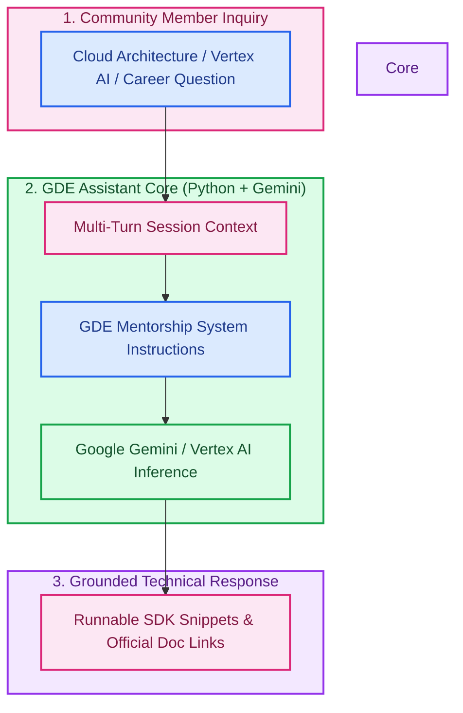

# GDE-Chatbot

> **Author & Architect:** [Robina Mirbahar](https://github.com/RobinaMirbahar) ([Google Developer Expert in Cloud & AI](https://developers.google.com/profile/u/106918534005910641104?utm_campaign=deveco_gdemembers&utm_source=deveco) · Google Cloud Champion Innovator · Co-Author of [*AI Engineering*](https://www.amazon.com/dp/B0GWCZWCF4))  
> **Focus:** Google Cloud & Gemini AI Community Assistant Built with Python, Vertex AI & Grounded Knowledge Retrieval

---

## 🎯 Why I Built GDE Community Assistant Chatbot (Engineering Purpose & Real-World Value)

### 1. 🤝 Scaling Developer Mentorship Across Community Events
As a Google Developer Expert (GDE), I frequently answer hundreds of recurring questions from students and builders about Google Cloud architecture, Vertex AI quotas, and learning paths. I built GDE-Chatbot as a grounded community assistant.

### 2. 📚 Context-Aware Multi-Turn Guidance
I engineered the session loop to preserve conversation history and provide runnable `gcloud` and Python SDK snippets tailored to the developer's experience level.

### 3. ⚡ Lightweight & Extensible Python Blueprint
The codebase is intentionally clean and modular so local GDG and WTM chapters can fork and deploy their own event assistant in minutes.

---

## 🏗️ System Architecture

---
---

### Official Google Developer Resources
- [Google Gemini API & AI Studio Docs](https://ai.google.dev/gemini-api/docs?utm_campaign=deveco_gdemembers&utm_source=deveco)
- [Google Cloud Vertex AI Documentation](https://cloud.google.com/vertex-ai/docs?utm_campaign=deveco_gdemembers&utm_source=deveco)
